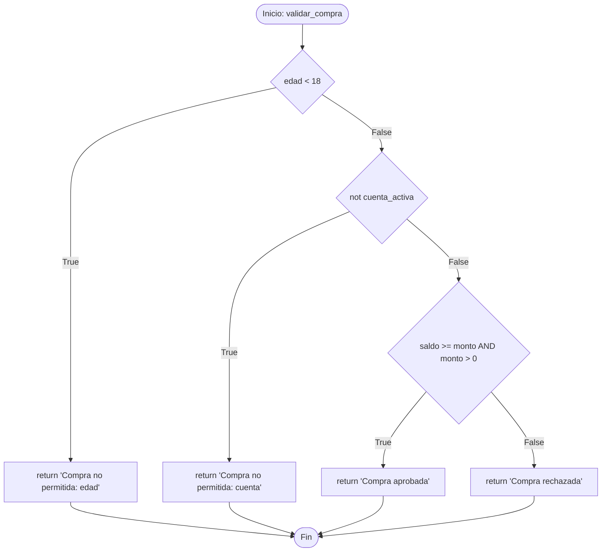

# Análisis de Caja Blanca: Función `validar_compra`

**Asignatura:** Testing & Quality Assurance (TQA)  
**Evaluación:** Examen Práctico Hito 3  
**Actividad:** 04 · Caja Blanca  

---

## 1. Código Fuente Bajo Análisis

El fragmento analizado corresponde a la función en Python provista en la diapositiva 7 del examen:

```python
def validar_compra(edad, cuenta_activa, saldo, monto):
    if edad < 18:
        return "Compra no permitida: edad"
    if not cuenta_activa:
        return "Compra no permitida: cuenta"
    if saldo >= monto and monto > 0:
        return "Compra aprobada"
    return "Compra rechazada"
```

### Entradas y Salidas
* **Parámetros de entrada:**
  * `edad` (numérico entero): Edad del cliente en años.
  * `cuenta_activa` (booleano): `True` si la cuenta está habilitada, `False` si está inactiva o suspendida.
  * `saldo` (numérico real): Fondos disponibles en la cuenta.
  * `monto` (numérico real): Valor monetario del producto o compra solicitada.
* **Salidas posibles (Returns):**
  1. `"Compra no permitida: edad"`
  2. `"Compra no permitida: cuenta"`
  3. `"Compra aprobada"`
  4. `"Compra rechazada"`

---

## 2. Identificación de Decisiones y Condiciones Simples

Para el análisis estructural es fundamental distinguir entre **decisiones** (estructuras de control de flujo compuestas o simples) y **condiciones simples** (predicados atómicos que evalúan a verdadero o falso).

| Identificador | Tipo | Expresión Lógica | Valores Posibles | Rama / Efecto |
|---|---|---|---|---|
| **D1** | Decisión simple | `edad < 18` | `True` / `False` | Si `True` -> Retorna mensaje de edad; si `False` -> pasa a D2 |
| **C1** | Condición simple | `edad < 18` | `True` / `False` | Condición atómica de D1 |
| **D2** | Decisión simple | `not cuenta_activa` | `True` / `False` | Si `True` (`cuenta_activa == False`) -> Retorna mensaje de cuenta; si `False` -> pasa a D3 |
| **C2** | Condición simple | `cuenta_activa` (o `not cuenta_activa`) | `True` / `False` | Condición atómica de D2 |
| **D3** | Decisión compuesta | `saldo >= monto and monto > 0` | `True` / `False` | Si `True` -> Retorna `"Compra aprobada"`; si `False` -> Retorna `"Compra rechazada"` |
| **C3** | Condición simple | `saldo >= monto` | `True` / `False` | Primera condición atómica de D3 |
| **C4** | Condición simple | `monto > 0` | `True` / `False` | Segunda condición atómica de D3 |

---

## 3. Grafo de Flujo de Control (CFG) y Complejidad Ciclomática

### 3.1. Diagrama de Flujo / Grafo



### 3.2. Cálculo de Complejidad Ciclomática $V(G)$
* **Por número de predicados/decisiones binarias simples ($P$):**
  $$V(G) = P + 1$$
  - Decisión 1: `edad < 18` (1)
  - Decisión 2: `not cuenta_activa` (1)
  - Decisión 3: `saldo >= monto and monto > 0` (al contener el operador lógico `and`, son 2 evaluaciones binarias a nivel de ramificación en tiempo de ejecución: `saldo >= monto` y `monto > 0`).
  - Considerando decisiones a nivel de bloques `if`: $P = 3 \implies V(G) = 3 + 1 = 4$ caminos independientes básicos.
  - Con desglose de cortocircuito booleano (`and`): $P = 4 \implies V(G) = 5$.
* **Caminos Básicos Linealmente Independientes (Mínimo = 4):**
  1. **Camino 1:** Inicio $\to$ D1 (True) $\to$ Retorno Edad $\to$ Fin.
  2. **Camino 2:** Inicio $\to$ D1 (False) $\to$ D2 (True) $\to$ Retorno Cuenta $\to$ Fin.
  3. **Camino 3:** Inicio $\to$ D1 (False) $\to$ D2 (False) $\to$ D3 (True) $\to$ Retorno Aprobada $\to$ Fin.
  4. **Camino 4:** Inicio $\to$ D1 (False) $\to$ D2 (False) $\to$ D3 (False) $\to$ Retorno Rechazada $\to$ Fin.

---

## 4. Criterios de Cobertura

De acuerdo a las definiciones teóricas de la materia:

1. **Cobertura de Sentencias (Statement Coverage):**  
   Busca que cada sentencia ejecutable del código sea ejecutada al menos una vez durante las pruebas.
2. **Cobertura de Decisiones / Ramas (Decision / Branch Coverage):**  
   Exige que cada punto de decisión tome todos los resultados booleanos posibles (`True` y `False`) al menos una vez.
3. **Cobertura de Condiciones (Condition Coverage):**  
   Requiere que cada condición simple dentro de una decisión compuesta sea evaluada independientemente como `True` y `False` al menos una vez.

### Determinación del Mínimo de Casos
* **Para Cobertura de Sentencias:**  
  La función cuenta con **4 sentencias `return` mutuamente excluyentes**. Como una sola ejecución solo puede alcanzar un `return`, el mínimo absoluto indispensable de casos de prueba para lograr el 100% de cobertura de sentencias es de **4 casos**.
* **Para Cobertura de Decisiones:**  
  Se deben cubrir las ramas `True` y `False` de D1, D2 y D3. Para ello se requieren como mínimo **4 casos** (correspondientes a los 4 caminos independientes).
* **Para Cobertura de Condiciones:**  
  Se requiere que C1, C2, C3 y C4 tomen ambos valores de verdad. Se requieren como mínimo **4 a 5 casos**.

---

## 5. Diseño de los 3 Casos Solicitados en el Examen

La diapositiva 8 solicita diseñar **3 casos concretos**:

| ID | edad | cuenta_activa | saldo | monto | Resultado Esperado | Condición / Decisión Cubierta |
|---|---|---|---|---|---|---|
| **TC-CB-01** | `16` | `True` | `500.0` | `100.0` | `"Compra no permitida: edad"` | Cubre **D1 = True** (C1: `16 < 18` es True). Ejecuta la sentencia `return` de la línea 3. |
| **TC-CB-02** | `20` | `False` | `500.0` | `100.0` | `"Compra no permitida: cuenta"` | Cubre **D1 = False** (`20 < 18` es False) y **D2 = True** (`not False` es True). Ejecuta la sentencia `return` de la línea 5. |
| **TC-CB-03** | `25` | `True` | `300.0` | `150.0` | `"Compra aprobada"` | Cubre **D1 = False**, **D2 = False** y **D3 = True** (C3: `300.0 >= 150.0` es True; C4: `150.0 > 0` es True). Ejecuta la sentencia `return` de la línea 7. |

---

## 6. Análisis Crítico: ¿Los 3 Casos Alcanzan el Criterio?

### Diagnóstico
**NO, 3 casos NO alcanzan el 100% de cobertura ni de sentencias ni de decisiones.**

### Justificación
1. **Sentencias:** La función posee 4 declaraciones de retorno. Los 3 casos diseñados solo ejecutan los primeros 3 `return`. La sentencia final `return "Compra rechazada"` (línea 8) **jamás es ejecutada**, alcanzando solo un **75% de cobertura de sentencias**.
2. **Decisiones:** La rama `False` de la decisión D3 (`saldo >= monto and monto > 0`) nunca es ejercitada, por lo que no se alcanza el 100% de cobertura de decisiones/ramas.
3. **Condiciones:** La condición simple C3 no ha sido evaluada a `False` (cuando el saldo es insuficiente) ni C4 a `False` (cuando el monto es $\le 0$).

### Ajuste Necesario para Cobertura Completa (100%)
Para subsanar esta brecha y alcanzar el **100% de cobertura de sentencias y decisiones**, es indispensable agregar un **cuarto caso de prueba (TC-CB-04)** y para cobertura estricta de condiciones un **quinto caso (TC-CB-05)**:

| ID | edad | cuenta_activa | saldo | monto | Resultado Esperado | Justificación del Ajuste |
|---|---|---|---|---|---|---|
| **TC-CB-04** | `30` | `True` | `50.0` | `100.0` | `"Compra rechazada"` | **Indispensable:** D1=False, D2=False, C3=`saldo >= monto` es False. Permite ejecutar la sentencia final `return "Compra rechazada"` alcanzando el 100% de sentencias y la rama False de D3. |
| **TC-CB-05** | `25` | `True` | `500.0` | `0.0` | `"Compra rechazada"` | **Condición C4 a False:** C3=`saldo >= monto` es True, pero C4=`monto > 0` es False. Garantiza 100% de cobertura de condiciones simples. |

---

## 7. Automatización y Verificación

Todos los casos de prueba (los 3 obligatorios del examen más los 2 de cobertura completa y casos límite) están implementados y verificados en código en:
- Código fuente: [`src/validar_compra.py`](file:///c:/Users/USUARIO/Desktop/UniF/Testing%20y%20QA/git/Examen%20practico/src/validar_compra.py)
- Pruebas unitarias: [`tests/test_caja_blanca.py`](file:///c:/Users/USUARIO/Desktop/UniF/Testing%20y%20QA/git/Examen%20practico/tests/test_caja_blanca.py)

Para ejecutar las pruebas en terminal:
```bash
python -m unittest tests/test_caja_blanca.py -v
```
Resultado: **9/9 tests passed (100% OK)**.
